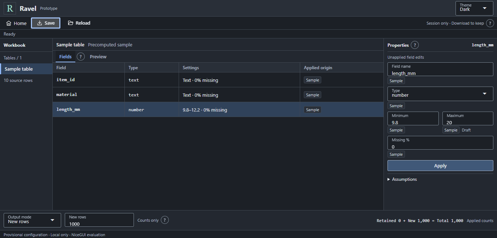

# Ravel

Ravel is an open-source tool for composing reproducible synthetic test datasets
from explicit rules or examples. **Dataset generation is still planned; the
current implementation is a fixture-based workbook prototype.**

**Compose the data you need.**



## Intended workflows

Both workflows are planned to use the same editable recipe:

- **Define a dataset from rules.** Specify fields, distributions, categories,
  missingness and constraints, then generate the requested records.
- **Start from an example.** Use a sample to guide settings, review its assumptions,
  and create a new dataset or retain the example rows and extend it to a target count.

Controlled distributions and missingness make unusual cases repeatable: test a
rare category, missing value or boundary without waiting for real data to contain
it. Constraints will express relationships that records must satisfy. Saved
recipes, seeds and recorded versions will make runs reproducible within a pinned
environment; validation will check the requested counts and rules and report
failures. These generation capabilities are **planned**, not implemented yet.

## Current workbook prototype

Try the shared editor through **Create from scratch** or **Start from a sample**.
The sample route uses an invented ten-row CSV with precomputed suggestions.
You can edit settings, distinguish applied values from drafts, correct inline
validation errors and save/reload a provisional JSON configuration. Light and
Dark themes are available.

The preview contains fixed illustrations and output controls calculate counts
only. The prototype does not generate data, infer settings or import arbitrary
samples. NiceGUI remains provisional; this is an early development preview,
not a supported application release.

### Quickstart

From a repository checkout, in PowerShell at the repository root with
Python 3.11 installed:

```powershell
py -3.11 -m venv .venv
.\.venv\Scripts\python.exe -m pip install -r experiments/workbook/requirements.lock
.\.venv\Scripts\python.exe -m pip check
.\.venv\Scripts\python.exe -m experiments.workbook.app
```

Open **http://127.0.0.1:8080/**; stop with Ctrl+C. Port 8080 must be free.
Installation needs network access; the running prototype serves assets locally.
Save configuration before closing the page: state is session-only.
Tested on Windows 11 with CPython 3.11.0, NiceGUI 3.18.0 and Chrome 154.

See the [development guide](docs/development.md#workbook-experiment) for setup,
checks, packaging evidence, review history and technical limitations.

## Documentation and contributing

- [Product plan](docs/plan.md) and [recipe architecture](docs/specification.md)
- [Clinical reference cases](docs/baseline-specification.md): an optional domain
  template, with invented specification examples rather than generated results
- [Environment proposals and decisions](docs/decisions.md)
- [Contributor guide](CONTRIBUTING.md) and
  [prototype dependency/license inventory](docs/dependency-licenses.md)

Development, including code and documentation, is AI-assisted. The maintainer
reviews and accepts changes; AI assistance does not establish clinical correctness.

Licensed under the [MIT License](LICENSE). Copyright 2026 Maksim Sendetski.
