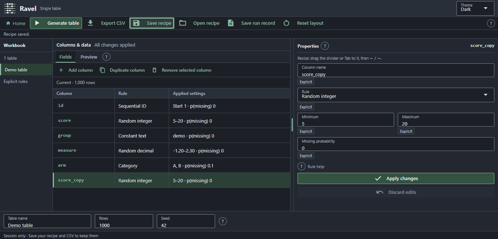

<picture>
  <source media="(prefers-color-scheme: dark)" srcset="brand/lockup/ravel-lockup-dark.svg">
  <source media="(prefers-color-scheme: light)" srcset="brand/lockup/ravel-lockup-light.svg">
  
</picture>

Ravel composes reproducible synthetic test data from explicit rules.
**The current source preview generates one table.** Sample import/profiling and
linked tables are planned next; this is not a supported application release.

**Compose the data you need.**



## Build a table

Add, duplicate, rename, configure and remove columns. Choose sequential IDs,
constant text, numeric sequences, bounded random integers/decimals or categorical
values with explicit probabilities. Set row count, seed and per-cell missingness,
then **Apply changes → Generate table**. Preview shows the first 100 actual rows;
**Export CSV**, **Save recipe** and **Save run record** retain the data, exact rules,
generating environment and checksums.

Unapplied or invalid edits cannot be silently ignored. Changed settings mark the
previous result **Out of date** and block CSV export until a current result is
generated. Column removal asks for confirmation. Drafts and errors survive theme,
view and layout changes. Drag the Properties divider or focus it and use arrows;
**Reset layout** restores its default preference, including after window resizing.

The headless engine and CLI use the same versioned recipe, validation and CSV
serializer as the UI. Stable field identities and separate random streams mean
adding an independent column preserves existing generated columns. Duplicated
columns get new identities. Reproducibility is scoped to the recorded environment.

### Source quickstart

Use standard **CPython 3.14.8 x64**, with the GIL enabled, on Windows. In PowerShell
at the repository root, create a separate source environment:

```powershell
py -3.14 -m venv .venv-source
.\.venv-source\Scripts\python.exe --version
.\.venv-source\Scripts\python.exe -m pip install -r requirements-ui.lock
.\.venv-source\Scripts\python.exe -m pip check
.\.venv-source\Scripts\python.exe -m ravel ui
```

Verify that the version command reports **3.14.8**. Open
**http://127.0.0.1:8090/** and choose **Create table**. Stop with Ctrl+C.
Installation needs network access; the app serves assets locally. Save before
closing the page: state is session-only. NiceGUI remains provisional.

### Headless example

The core and CLI need only the standard library. With the same interpreter:

```powershell
New-Item -ItemType Directory -Force outputs/tryout
.\.venv-source\Scripts\python.exe -m ravel validate examples/three-rows.recipe.json
.\.venv-source\Scripts\python.exe -m ravel generate examples/three-rows.recipe.json --csv outputs/tryout/reference.csv
```

Expected rows: `(1, demo, 10)`, `(2, demo, 12)`, `(3, demo, 14)`. The CLI writes
CSV, canonical `.recipe.json` and `.run.json` sidecars and refuses to overwrite
existing files. Choose a fresh output filename for another run.

The [single-table contract](docs/single-table.md) defines bounds, decimal scale,
probability semantics, CSV and limits. The app explicitly rejects the old
workbook experiment JSON; it never silently migrates or overwrites the original.
Sample import, exact quotas, arbitrary distributions, dependencies, linked tables,
clinical derivations and binary distribution are outside this increment. Both
generic entry paths remain required for the first usable release.

See the [development guide](docs/development.md#single-table-source-development)
for maintained checks and a short walkthrough. Historical
[fixture experiment instructions](docs/development.md#workbook-experiment) and
packaging evidence remain available, with their original scope.

## Documentation and contributing

- [Product plan](docs/plan.md) and [recipe architecture](docs/specification.md)
- [Clinical reference cases](docs/baseline-specification.md): an optional domain
  template, with invented specification examples rather than generated results
- [Environment proposals and decisions](docs/decisions.md)
- [Contributor guide](CONTRIBUTING.md) and
  [prototype dependency/license inventory](docs/dependency-licenses.md)

Development, including code and documentation, is AI-assisted. The maintainer
reviews and accepts changes; AI assistance does not establish clinical correctness.

Licensed under the [MIT License](LICENSE). Copyright 2026 Maksim Sendetski.
