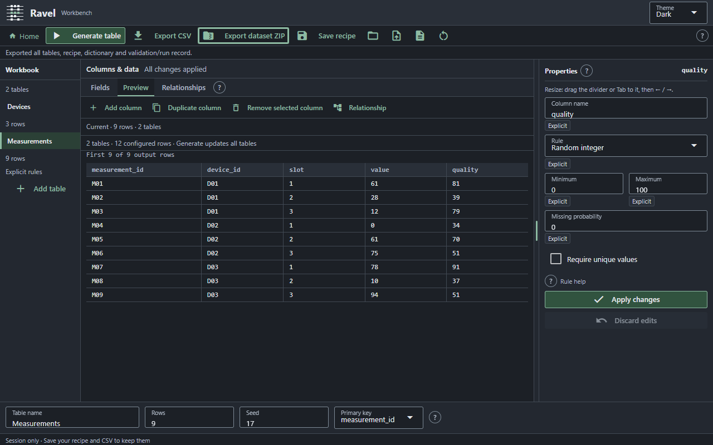
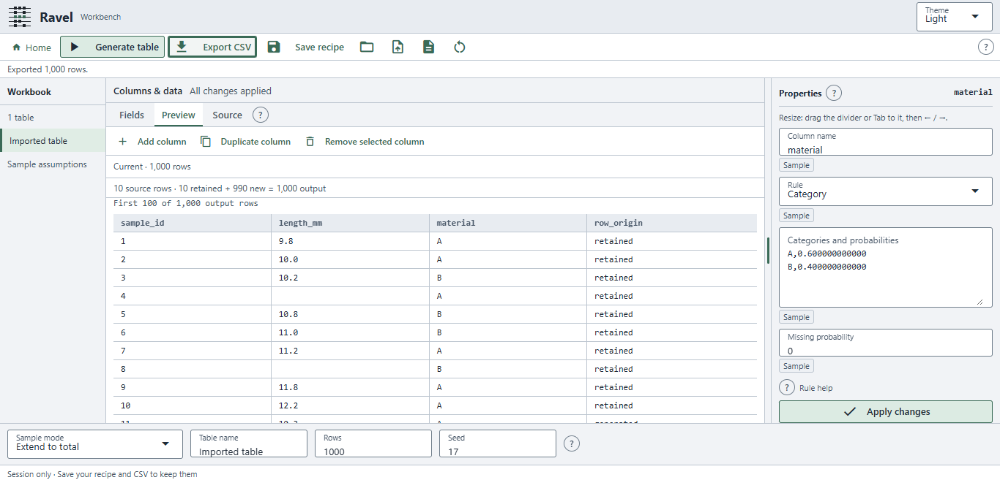

# Private Windows candidate verification, 18–19 October 2026

The available development-host work for [#17](https://github.com/Maks1m-Se/ravel/issues/17)
is prepared for review. The candidate is private, unsigned and unaccepted.
The external clean-Windows prerequisite and redistribution findings below remain
open. Project status stays in [progress.json](progress.json); no release gate or
M0/full M1 acceptance follows from these checks.

## Exact candidate

| Item | Recorded value |
| --- | --- |
| Content version | `source-b99a360a14c4eb8d` |
| Declared-input fingerprint | `b99a360a14c4eb8d05b2943c8af078535efec5190e187a8005a91f985b4e7a57` |
| Actual Git base at build | `709966be3503ea5c39edc9f13a117feea4138c8c`, with dirty source state recorded |
| Primary ZIP | `Ravel-source-b99a360a14c4eb8d-windows-x64-private.zip` in local `win-c` |
| Primary ZIP SHA-256 | `eedbb78764c6913e6685a474e1ce17ee31ae9ba6c057880641b6237138eaae91` |
| Primary Ravel.exe SHA-256 | `d7bdce6b9a17a4433879477c2f512216bc3e43de3759ad7bbdacdb1a84670b96` |
| Independent rebuild ZIP SHA-256 | `1dfcfd0d9031941f8089be67f931919528e07fca4b422fc301420e3312df2b2f` in local `win-d` |

The content fingerprint covers the builder's declared inputs, including runtime,
fixtures, locks, packaging scripts and bundled notice/instruction documents.
It is distinct from the exact ZIP hash. Later evidence, screenshots, progress
and dashboard updates are outside that build-input set. The candidate was not
built from a subsequently created publication commit. The published implementation
is `5b5dbc2fc1a8e06d410c13b216d072d7b2f6c85f`: the publisher compared every checked
runtime/test/script blob with the tested snapshot using explicit LF normalization,
then verified the remote ref. Ten GitHub blobs were separately read back and
matched, including both runtime entrypoints, builder/support/launcher, both locks,
this initial report and both unchanged screenshots.

## Actual checks

Two fresh isolated Windows x64 environments use standard CPython 3.14.8 with the
GIL, exactly 48 runtime pins and seven build pins. Both were assembled offline
from prepared wheels, passed dependency checking and matched the exact 55-package
inventory before building. pip and browser/font-review tools are outside them.
NiceGUI is 3.18.0; PyInstaller is 6.20.0 and setuptools is 80.9.0. This selects
the bounded private binary setup; it does not adopt every platform or NiceGUI
for the final product. See [build instructions](windows-preview.md).

| Check | Actual result |
| --- | --- |
| Core | All 82 unit methods pass, including inventory rejection, manifest tampering, CLI port forwarding and normal UI shutdown |
| Both actual EXEs | Frozen imports resolve inside the bundle; hand three-row CSV, sample 1,000-new/extend/replay, extended rules and linked exports pass; existing output and clinical review-sheet rejection pass |
| Primary packaged UI | All 16 Chrome cases pass: explicit/sample/extended/linked × Light/Dark × 1366×657/1280×800; one separate Edge linked case passes |
| UI assertions | Real Preview/CSV/CLI bytes, keyboard focus, Properties resize/preferences, identifier confirmation, retained originals/origins, invalid/unapplied edits, stale export, relationship/count review and complete dataset ZIP pass |
| Browser observations | Zero page errors and zero external HTTP/WebSocket attempts under interception; actual final captures inspected |
| Primary console lifecycle | Normal console Ctrl+C event: exit 0, port 8102 closed, zero server tracebacks |
| Rebuild console lifecycle | Separate start/stop on port 8112: exit 0, port closed, zero server tracebacks |
| Clean rebuild comparison | Same declared inputs, exact environment and output paths; every stable file byte matches, as does every decoded member of both ZIP containers |
| Container variability | Ravel.exe, base_library.zip and corresponding-source.zip bytes vary; no missing/added files or unexpected stable-content changes; no bit-identical executable/ZIP claim |
| Repository | Dashboard regeneration/freshness and Git whitespace checks pass; final source/evidence snapshot retained locally |

The packaged checks ran on the existing Windows development host with Python
installed, Playwright 1.58.0, Chrome 155.0.8059.82 and Edge 155.0.4283.62.
They establish packaged behavior on this host. They do not establish installation
without Python or physically disconnected cold start.

The initial console test exposed an unhandled KeyboardInterrupt even though
the port closed. A regression reproduced it; the UI command now reports normal
shutdown successfully. Both final executables were rebuilt after that repair.
Earlier failed builds, long-path errors, intermediate browser runs and console
diagnostics remain retained and are not counted as final passes.

## Actual Windows protection result

On 19 October, 13:36:16–13:37:15 UTC, the installed Microsoft Defender native
custom scan examined the complete primary folder. MpCmdRun exited 0 and reported
no threats; candidate-filtered threat history contains zero detections. Every
manifest file remained unchanged after the scan. No protection setting changed.

| Observation | Before and after |
| --- | --- |
| Host | Windows 11 Home 26H2, x64, build 26300.9711 |
| Defender application / engine | 4.18.26090.9 / 1.1.26090.9 |
| Defender signature | 1.461.102.0 |
| Antivirus / real-time protection | Enabled / enabled |
| Smart App Control | Off, pre-existing state; not changed for this work |
| Authenticode | NotSigned |
| PowerShell policy | Restricted on live readback; all configured scopes Undefined; no policy change or bypass |
| SmartScreen | Local unsigned execution succeeded; a real downloaded-file reputation prompt was not tested |

The tracked `check_windows_protections.py` calls the official native scanner
and records the status, raw scan result, relevant detections and unchanged
manifest. It does not weaken policy or antivirus settings. A successful custom
scan does not establish future reputation or clean-machine acceptance.

## Actual contents and redistribution review

The final manifest and analysis inventory were checked against supplied material:
55 exact pinned Python sdists, CPython 3.14.8 source and Windows x64 SPDX data,
the tagged NiceGUI core extraction script/lock, and 107 npm lock entries with
verified archive integrity and retained supplied notices/source. All 16 actual
font files were separately decoded and their hashes match the retained metadata.
Eight retained direct-copy core JavaScript assets match their exact upstream
bytes. The artifact inventory records 118 JavaScript files, 86 DLL/PYD files and
75 loose Docutils files, with no Docutils editor/emacs helper.

Eleven unused lazy element asset families and unused nonproduction Vue/Quasar
files are excluded with a local packaging hook and explicit omission checks.
The full browser matrix above tests this narrowed artifact. Notice texts use
short content-addressed paths while their component records preserve original
paths, complete hashes and copied locations. Environment-specific installation
RECORD files and incidental notice-directory bytecode are excluded; the actual
artifact manifest remains authoritative. Original environments and supplied
source archives are unchanged.

Retaining sources and notices does not finish public redistribution review.
Concrete open findings are transformed Sass/Immutable/DOMPurify correspondence,
font-variant license/source correspondence, native/Rust vendor file coverage and
Microsoft runtime terms. See [artifact notice review](windows-preview-notices.md).
No binary, release, tag or public artifact upload is authorized by this record.

## Published review chain and hosted checks

All listed PRs remain draft and unmerged. Each feature PR depends on the
preceding branch; review them in this order. The Windows package is published on
`feature/windows-preview`, based on the clinical-preparation branch. The original
`feature/staged-generator-batch` working tree and its saved work remain preserved.

| Review | Exact published commit | Hosted core evidence |
| --- | --- | --- |
| [#10 recipe repair](https://github.com/Maks1m-Se/ravel/pull/10) | `d9bcec2a752c382b17e8e90d40a7986e8bb2639f` | [43 tests per OS](https://github.com/Maks1m-Se/ravel/actions/runs/39082191160) |
| [#18 sample workflow](https://github.com/Maks1m-Se/ravel/pull/18) | `b6fae41a4ef72b22d2bbe9d48a97fa4f5d6d25bd` | [54 tests per OS](https://github.com/Maks1m-Se/ravel/actions/runs/39138603515) |
| [#19 UX and skill](https://github.com/Maks1m-Se/ravel/pull/19) | `9e86648bde08f38d7cffd77f17f2fad251d8bd52` | [55 tests per OS](https://github.com/Maks1m-Se/ravel/actions/runs/39138626951) |
| [#20 extended rules](https://github.com/Maks1m-Se/ravel/pull/20) | `d0aec989c5f756b8b7c6c3f021784d1625348cd8` | [65 tests per OS](https://github.com/Maks1m-Se/ravel/actions/runs/39138670144) |
| [#21 linked tables](https://github.com/Maks1m-Se/ravel/pull/21) | `6a50e5fa6c89683aade934260378434cd81b71d3` | [76 tests per OS](https://github.com/Maks1m-Se/ravel/actions/runs/39139225278) |
| [#22 clinical preparation](https://github.com/Maks1m-Se/ravel/pull/22) | `f96a1def5c7b0a7412c6cd7faeb98a7f8b88dca8` | [78 tests per OS](https://github.com/Maks1m-Se/ravel/actions/runs/39139720429) |
| [#23 private Windows preparation](https://github.com/Maks1m-Se/ravel/pull/23) | `5b5dbc2fc1a8e06d410c13b216d072d7b2f6c85f` | [82 tests per OS](https://github.com/Maks1m-Se/ravel/actions/runs/39312807595) |

All 15 sample-through-clinical hosted job logs were read: Windows, Ubuntu and
macOS each passed the stated unit count, dashboard freshness and whitespace.
Earlier repair job logs separately establish its 43-test result. The new Windows
preparation run was also read in full: Ubuntu job118266508679 (82 tests,2.175s),
macOS job118266509211 (82,1.752s), Windows job118266509246 (82,3.460s), each with
successful dashboard and whitespace steps. These are hosted core checks, with
no packaging/native/clean-machine job. E46 human acceptance remains attributed
only to its earlier exact tested sources; E42 and PR #8 history remain preserved.

## Joint function test

Open **http://127.0.0.1:8101/**. This separate manual-only instance is frozen at
commit `6a50e5fa6c89683aade934260378434cd81b71d3`, snapshot
`linked-E53-323bae982692`, runtime fingerprint
`323bae982692f05f72e5fdbb72e0fd9653acabea6a782251eee0335cc3a9351a`.
Its files were checked and the same instance resumed on 19 October. Ongoing
edits and automated browser runs use other roots and ports. Repair-only port
8100 remains separate. This manual snapshot predates Windows launcher changes.

1. Create a table, generate 1,000 rows, edit/add/duplicate a column. Check errors
   and stale-export protection, then Apply/Generate, CSV and recipe save/reload.
2. Import `examples/sample-assisted/ten-rows.csv`. Inspect and edit assumptions,
   confirm the identifier, try 1,000 new and Extend to total 1,000. Expect exact
   originals first, 990 new rows and explicit row_origin in the extension.
3. Load `examples/extended-rules/three-days.recipe.json`; inspect leap day,
   Boolean, uniqueness and exact counts. Make an impossible request and recover.
4. Home > Use template > Devices / measurements: expect three devices and six
   measurements. Review/cancel/apply a relationship change, switch tables with
   the keyboard, then export the complete ZIP and save/reload the recipe.

Repeat the same workflows against the extracted private candidate using the
[start/stop instructions](windows-preview.md). Its normal console lifecycle is
automated evidence above; native keypress, file picker, default browser,
physically disconnected start and real download-origin SmartScreen behavior
still need the [clean-Windows checklist](windows-preview.md#clean-windows-review-checklist).
No clean guest or second Windows computer without Python is currently available.
Review the clinical proposal separately before implementing clinical arithmetic.

Raw final reports are retained under local `outputs/ravel-batch-2026-10-17`:
`win-c-cli`, `win-d-cli`, `win-c-browser`, `win-d-lifecycle`,
`windows-final-rebuild-comparison.json`, `windows-final-candidate-asset-audit.json`,
`windows-final-protections.json`, `windows-ready`, `windows-publication-ready`,
`windows-published-readback.json` and the three new CI job logs. Older unsuccessful evidence
is preserved alongside them.

## Independent access handoff, 20 October 2026

The exact existing ZIP and prior verification files were copied without rebuilding
to `C:\Git\ravel\outputs\private-review-b99a360a14c4eb8d\`.
The original remains intact. The copied ZIP's full SHA256 matches the primary
hash above. All252 handoff files are individually verified git-ignored by the
existing /outputs/ rule. REVIEW-IDENTITY.txt explains extraction/start/stop and
the original evidence; handoff-verification.json records each copied hash.

This is the older b99a360a14c4eb8d artifact. It predates the separate
[pending-action UX correction](development.md#pending-apply-discard-review-20-october-2026).
New native results must identify this exact ZIP and cannot accept the later UX.
Use the matching older source/harness when automating this package; the new
pending-action browser workflow deliberately expects behavior absent from it.
No clean-machine, physical-offline, download-reputation or redistribution finding
is resolved merely by making the artifact accessible. Keep independent raw
commands/logs/captures separate from the included earlier ChatGPT host evidence.
